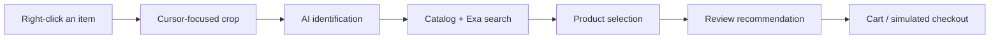

<div align="center">


# Needle

### See it. Right-click it. Shop it.

**Team 9 Project · Top 10 at AI Grand Prix Singapore, organised by OpenAI and Coupang**

An AI shopping assistant that turns a right-click into product discovery, recommendations, and shopping—without leaving the page.


**[Explore the website](https://haoming9527.github.io/Needle/) · [Architecture](docs/ARCHITECTURE.md)**

</div>

---

## Meet Needle in action

<!-- Keep this attachment URL on its own line: GitHub renders it as a video player. -->

https://github.com/user-attachments/assets/32cb2435-9694-4d49-b397-e043b2466502

## Shopping starts with what catches your eye

A pair of headphones in a video. A lamp in an article. A bag in a social post. You know what you want when you see it—but finding it usually means opening another tab and guessing what to search.

Needle makes the item itself the starting point. Right-click near it, and the agent uses the cursor position and a focused image crop to identify the object, search for suitable products, and prepare the next step.

> **Prototype checkout · No payment taken.** Purchases are simulated; Needle does not place orders with merchants.

## From inspiration to a cart

| Step | What happens |
| --- | --- |
| **01 · Point** | Right-click an item in an image, video, or ordinary webpage—including X. |
| **02 · Discover** | Needle identifies the object around your cursor and searches its catalog, with Exa web fallback. |
| **03 · Decide** | Review a recommended product, its price, source, and match quality. |
| **04 · Shop** | Add it to your cart or choose **Buy** to review and confirm a simulated purchase. |

When the target is unclear, answer a short question by typing or using the microphone. Your answer stays attached to the original selection.

## Built for the moment

- **A three-control popup:** Buy, Add to cart, and ×. It stays beside the item while the agent works.
- **Cursor-aware vision:** a focused crop and marked reference help the agent understand which object you mean.
- **Catalog + web discovery:** prepared products and cached discoveries live in SQLite; Exa helps find products beyond them.
- **AI product selection:** OpenAI evaluates candidates against the selected object and your preferences.
- **Voice clarification:** record a reply, review the transcript, and submit it when ready.
- **Persistent cart and history:** revisit finds, review receipts, and clear unused shopping data.
- **Your normal browser, when you want it:** switch Needle off or hold **Shift + right-click** for the original menu.

## Take a quick tour

The [public website](https://haoming9527.github.io/Needle/) introduces Needle through a guided tour, an animated right-click example, sample finds, and a seller workspace.

The website is a static showcase. Run the extension locally to try capture, the agent, cart, and purchase history.

## Quick start

**You’ll need:** Node.js **22.13+**, npm, Git, and Google Chrome **116+**.

| Configuration | What you can try |
| --- | --- |
| No API keys | Text-based searches in the prepared catalog, cart, and simulated checkout |
| `OPENAI_API_KEY` | Image recognition, catalog recommendations, product selection, and voice replies |
| OpenAI + `EXA_API_KEY` | The full flow, including web fallback when the catalog has no suitable match |

### 1. Install

```bash
git clone https://github.com/Haoming9527/Needle.git
cd Needle
npm install
```

Copy `.env.example` to `.env` if you do not already have one, then fill in your keys:

<details>
<summary>Copy commands for your terminal</summary>

**PowerShell**

```powershell
if (-not (Test-Path .env)) { Copy-Item .env.example .env }
```

**macOS / Linux**

```sh
[ -f .env ] || cp .env.example .env
```

</details>

```dotenv
OPENAI_API_KEY=your_openai_key
EXA_API_KEY=your_exa_key
```

Keep the other defaults from [.env.example](.env.example), or choose models available to your account. Keys stay on the local backend. Restart the API after changing `.env`.

### 2. Start the local app

```bash
npm run dev
```

This starts the API at `http://127.0.0.1:4318` and the [shopping panel](http://127.0.0.1:5173/panel.html). These addresses work only while the app is running on your own computer. Keep the API on port **4318**; the packaged extension connects to that address.

### 3. Load the extension

In a second terminal:

```bash
npm run build
```

1. Open `chrome://extensions` and enable **Developer mode**.
2. Click **Load unpacked** and select this checkout’s **`dist/extension`** folder.
3. Allow Needle access to the pages you want to use, then right-click an item on an ordinary HTTP/HTTPS webpage.

After changing extension code, rebuild and click **Reload** on Needle’s extension card. Browser-internal pages and the Chrome Web Store do not support the custom popup.

After building, you can run **`npm start`** instead of `npm run dev` if you only need the installed extension. It starts the API without the panel development server.

For voice, permissions, model overrides, troubleshooting, and the full API reference, see the [local development guide](docs/LOCAL_DEVELOPMENT.md).

### Troubleshooting

| Symptom | What to check |
| --- | --- |
| The original right-click menu appears | Turn Needle on, check Chrome site access, and reload the extension after rebuilding. **Shift + right-click** intentionally opens the original menu. |
| Cannot connect to the agent | Keep `npm start` or `npm run dev` running. Check that [the local API](http://127.0.0.1:4318/health) responds on port 4318. |
| Image search or voice is unavailable | Set `OPENAI_API_KEY`, check the configured models are available to your account, and restart the API. |
| No suitable catalog product | Add `EXA_API_KEY` for web fallback, or refine the selection with a description. |
| A video crop is black | Protected players can block capture. Use a text description or an accessible product image. |
| `EBUSY` while watching a media file | Keep presentation videos outside the source checkout, or use `npm start` with the built extension. The README’s uploaded video does not need a local MP4. |

## Under the hood



| Layer | Technology |
| --- | --- |
| Browser experience | Chrome Manifest V3, React, TypeScript |
| Agent workflow | Vercel AI SDK, OpenAI |
| Web discovery | Exa |
| Local API | Node.js, Express |
| Persistence | SQLite |
| Build and checks | Vite, esbuild, Vitest |
| Public showcase | React, GitHub Pages |

The agent searches and recommends; cart changes and checkout are separate user actions. Repeated confirmation identifiers return the same receipt to prevent duplicate purchases.

## Project map

```text
src/extension/     Right-click popup, capture, and browser messaging
src/panel/         Recommendations, checkout, cart, and history
src/voice/         Browser recording and transcription client
server/agent/      Identification, search workflow, and product selection
server/providers/  Catalog and Exa retrieval
server/storage/    SQLite persistence and prepared products
shared/            Browser/server contracts and presentation rules
website/           Public showcase and guided tour
tests/             Regression tests and development fixtures
docs/              Architecture, setup, requirements, and verification
```

## Development

| Command | Purpose |
| --- | --- |
| `npm run dev` | Start the local API and panel |
| `npm start` | Run only the API for the installed extension |
| `npm run build` | Type-check and package the extension |
| `npm test` | Run the regression suite |
| `npm run dev:site` | Develop the public website |
| `npm run build:site` | Build the website into `dist/website` |
| `npm run preview:site` | Preview the built website locally on port 4180 |
| `npm run check:coverage` | Check configured web retrieval coverage |

**[Architecture](docs/ARCHITECTURE.md) · [Local development](docs/LOCAL_DEVELOPMENT.md) · [Requirements](docs/REQUIREMENTS.md) · [Verification](docs/VERIFICATION.md) · [Website](website/README.md)**

<details>
<summary><strong>Data, privacy, and prototype scope</strong></summary>

- Capture starts after a user gesture. The backend receives the focused crop and a marked reference, not an ongoing screen recording.
- API keys remain in `.env`; local shopping data lives in `.local/needle.sqlite`. Both paths are ignored by Git.
- Captured images are not stored in the catalog database. Voice recordings are processed in memory.
- Prepared catalog prices and variants are illustrative. Web-derived products retain their original source; illustrative prices are identified in Product details.
- Amounts keep their original currencies. Totals are grouped by currency rather than silently converted.
- The prototype does not verify merchant inventory, process payments, or automate real checkout.

</details>

## Team 9

Built for **AI Grand Prix Singapore**.

Our idea: make AI the primary shopping interface, moving discovery from search boxes to the things people already see and want.

<div align="center">

**Needle · Your eye. Your finds.**

</div>
